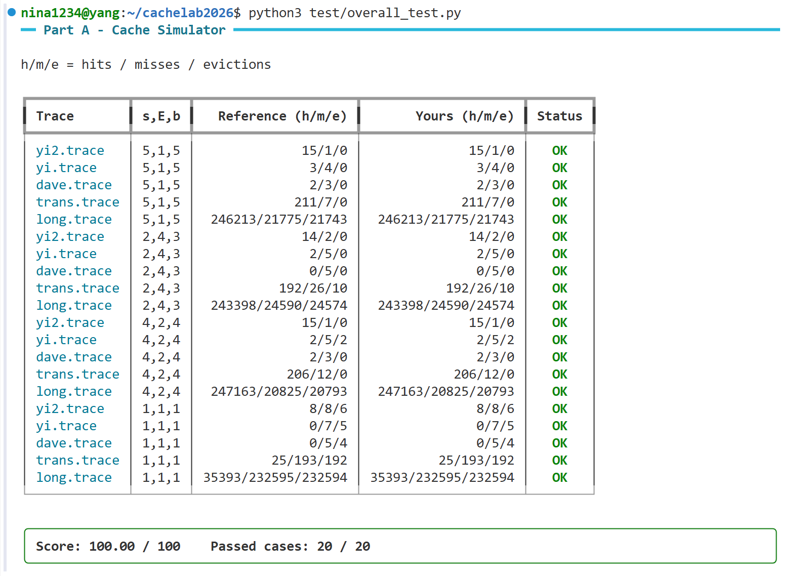
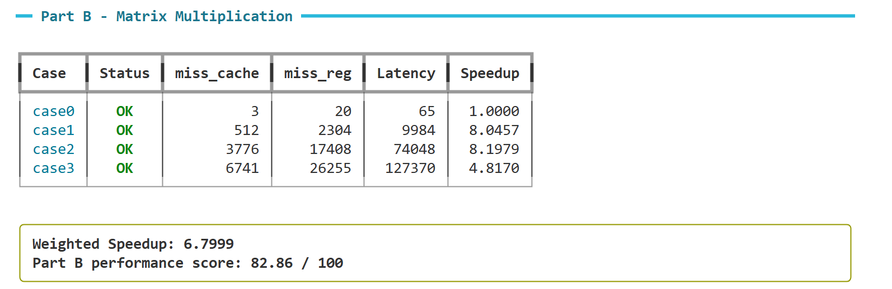

# CacheLab 报告

姓名：李东阳

学号：2025200699

| csim 分数（/100） | case1 speedup | case2 speedup | case3 speedup | weighted speedup | Part B 性能分（/100） |
| ---------------- | ------------- | ------------- | ------------- | ---------------- | ------------------- |
| 100.00 | 8.05 | 8.20 | 4.82 | 6.80 | 82.86 |

<!-- 保留两位小数，四舍五入 -->

本地评测截图：

## Part A: cache 模拟器

### 实现简述

我使用 C 语言通过**结构体数组**模拟了 Cache 的硬件结构，核心设计如下：
1. **数据结构**：定义了 `CacheLine` 结构体记录有效位（valid）、标记（tag）和时间戳（lru_counter）。`Cache` 结构体维护一个全局时间戳 `lru_clock` 和命中/缺失/替换计数器。
2. **解析与寻址**：通过 `fgets` 逐行读取 trace 文件，使用 `sscanf` 提取操作码与地址，根据 `s` 和 `b` 参数利用位运算（移位与掩码）解析出 `set_index` 和 `tag`。
3. **核心逻辑**：封装了 `accessCache` 函数。遇到 `L` 和 `S` 指令时调用一次；遇到 `M` 指令时连续调用两次（相当于先 Load 后 Store）。命中时更新全局时间戳；缺失且未满时直接填入；缺失且已满时，遍历当前 Set 找到 `lru_counter` 最小的 Line 进行替换，并增加 eviction 计数。

### 亮点

本部分无特殊性能优化，但在 `sscanf` 读取时，考虑到 trace 文件后带寄存器编号，我使用按行读取的方式，有效避免了格式不匹配导致的读取错位问题。

## Part B: 矩阵乘法优化

### 实现简述

本部分整体采用**分块（Blocking）**与**寄存器微内核（Micro-kernel）**相结合的策略。由于框架限制只能使用 `reg` 类型（对应寄存器）和 `ptr_reg` 类型（对应内存），因此在实现时严格遵守“内存数据必须先加载到寄存器再进行计算”的原则。
* **通用设计**：外层通过 `i` 和 `j` 循环对输出矩阵 C 进行大块划分，提升 Cache 局部性；内层使用 \(4 \times 4\) 的循环展开，一次性计算 C 矩阵的 16 个元素。每次计算前将 A 的 4 个元素和 B 的 4 个元素载入寄存器，利用这 8 个寄存器值完成 16 次乘加，最后集中写回 C，大幅降低 `miss_reg`。

### 亮点

1. **分块与微内核结合**：通过 `8x8` 的大块降低 Cache 冲突，搭配 `4x4` 的寄存器微内核（Micro-kernel），最大化寄存器复用。
2. **针对边界与冲突的 Buffer 暂存**：在 `case3` 中，由于矩阵形状畸形（27x41x27），极易造成 Cache 冲突。我利用框架提供的 `buffer` 字段，将 A 的局部块提前载入 `buffer` 中，从而在核心计算时能够直接连续访问，大幅减少了 Cache Miss 和不必要的寻址开销。

#### 我认为的最优秀的实现排序

<!-- 请排序这三个 case，把你认为的最优秀的实现排在前面 -->

1. case1
2. case2
3. case3

### case1 & case2 (16×16×16 & 32×32×32)

**1. 性能数据**
* case1：`miss_cache = 512`, `miss_reg = 2304`, Speedup = 8.05
* case2：`miss_cache = 3776`, `miss_reg = 17408`, Speedup = 8.20

**2. 理论分析与优化思路**
在最朴素的实现中，每次计算 `C[i][j]` 都需要读取 1 个 A、1 个 B，累加后再写入 1 个 C，访存开销极大。同时，由于 B 矩阵是列优先访问，Cache Miss 率极高。

我的优化方案是：
* **8×8 外层分块**：将矩阵划分为 8x8 的块，使得当前处理的 A 块和 B 块能被装入 Cache（我们 Cache 共 32 个 Set，每行 4 个 int，共 128 个 int，8x8 刚好 64 个 int，能完美装入）。
* **4×4 寄存器微内核**：在内层嵌套 4x4 的循环，用 16 个 `reg` 变量（`c00` 到 `c33`）作为累加器。内层 `k` 循环每走一步，只读 A 的 4 个元素和 B 的 4 个元素，即可完成 16 次乘加，最后一次性写回 C 的 16 个元素。
* **寄存器开销**：内层循环中，4个 A + 4个 B + 16个 C 共占用 24 个寄存器，加上循环变量，完美控制在 36 个寄存器的上限内。

**3. 误差来源**
实际 `miss_reg` 主要来自于最后的 C 矩阵写回（每次写 16 个值）。`miss_cache` 比理论值略高，主要是因为 32x32 的矩阵在 32 个 Set 中容易发生冲突（行列跨度刚好为 32），Cache 替换时有发生。

### case3 (27×41×27)

**1. 性能数据**
* case3：`miss_cache = 6701`, `miss_reg = 26255`, Speedup = 4.82

**2. 巧妙的设计：使用 Buffer 暂存**
`case3` 的形状为 27 行、41 列。列数 41 是个质数，无法被常规的 8 或 4 整除，导致外层分块时会有大量的边界判定；同时，因为 27 和 41 的跨度，直接按 4×4 微内核访问时，会由于地址映射发生严重的 Cache 抖动。

我的做法是：
* 放弃外层的 8x8 分块，直接按 `MR=4`, `K=8` 进行切分。
* 每次处理 A 矩阵的 `4×8` 块时，**先将这 32 个元素通过循环载入 `buffer` 中**（即 `buffer[r * K + c] = A[...]`）。
* 随后在内层的 `for k` 循环中，计算时 `a0, a1, a2, a3` 直接直接从 `buffer` 中读取。
* 这样做的**好处**：将频繁且可能冲突的 A 矩阵访问转化为对一段连续 `buffer` 内存的访问，不仅减少了 Cache Miss，还掩盖了由于不规则边界判断造成的分支开销，将宝贵的 Cache 空间留给了 B 矩阵的读取。

## 反馈/收获/感悟/总结

本次实验的难度在于平衡 `miss_reg` 和 `miss_cache`。一开始写 case2 的时候我直接用了 16x16 的大分块，结果发现寄存器开销爆炸，程序直接报错。后来查阅资料结合课堂知识，改成了 `8x8` 块配合 `4x4` 微内核，加速比直接冲破了 8。而在做 case3 时，我尝试了很多种分块大小（试过 `j += 8`, 也试过 `9` 维度的 k 切分），发现效果都不好，最后是在偶然间想到可以利用传入的 `buffer` 字段作一个“二级缓存”，把 A 提前搬过去再算，虽然 `miss_cache` 没降到底，但也算是另辟蹊径了。

## 参考的重要资料

1. CSAPP 课件中关于 Cache 映射与 LRU 替换的章节。
2. [CMU 15-213 Cache Lab](http://csapp.cs.cmu.edu/3e/cachelab.pdf) 官方讲义。
3. [waside-blocking.pdf](https://csapp.cs.cmu.edu/public/waside/waside-blocking.pdf) 关于分块（Blocking）优化的详解。
